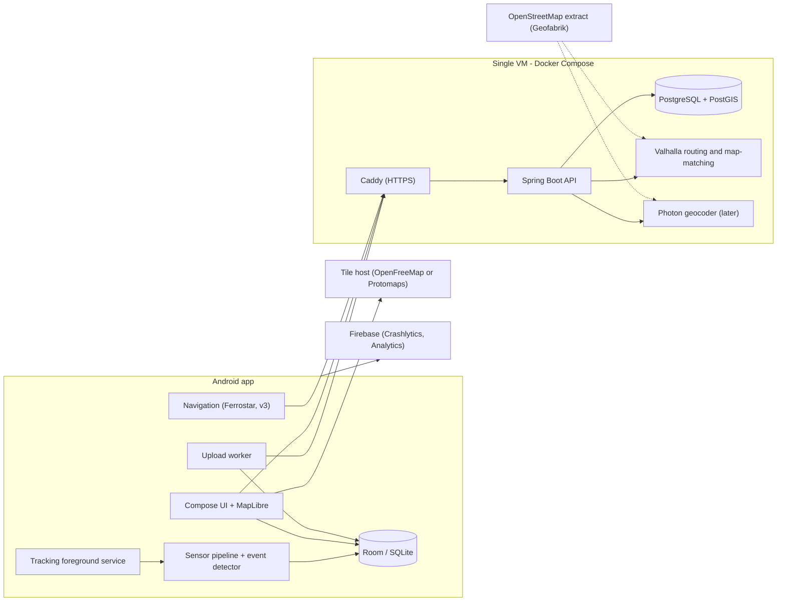
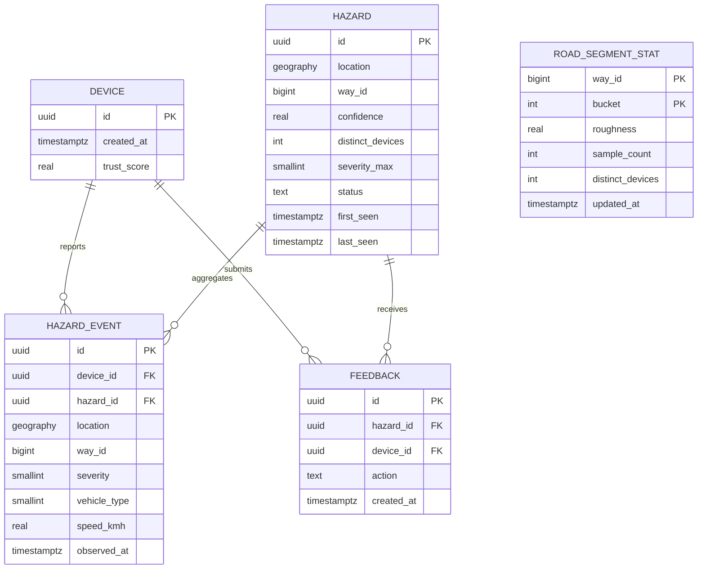
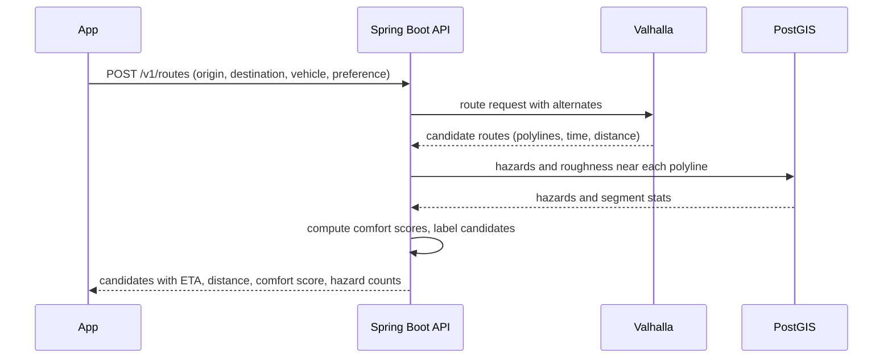
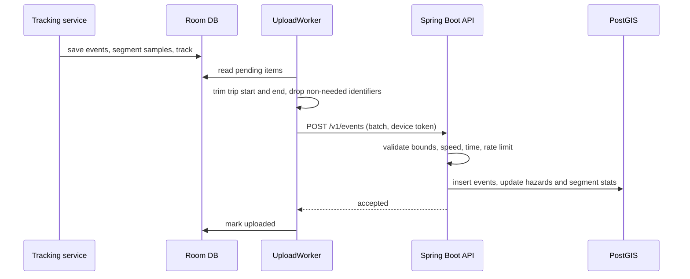

# Architecture

**Product:** Road Quality Mapper (working title)
**Status:** Draft v0.1
**Related:** [PROJECT_OVERVIEW.md](PROJECT_OVERVIEW.md), [PRD.md](PRD.md)

All numeric parameters in this document (thresholds, windows, weights) are **initial values to be tuned with real field data**.

---

## 1. Purpose and scope

This document describes how the system is built: the Android app, the backend, the data model, the main flows, deployment and the upgrade path. It covers all phases (v1 to v4) and marks which parts arrive when.

| Phase | Architecture needed |
|---|---|
| v1 | Android app only (sensing, detection, Room, MapLibre). No backend. |
| v2 | Backend (Spring Boot, PostGIS), Valhalla, geocoding, upload, aggregation |
| v3 | Navigation (Ferrostar), alerts, photo storage |
| v4 | Complaint generation, report cards, open data export |

## 2. System context



## 3. Components

| Component | Responsibility | Phase |
|---|---|---|
| Android app | UI, sensing, on-device detection, local storage, upload, map, navigation | v1+ |
| Spring Boot API | Ingestion, aggregation, hazard and route APIs, geocoding proxy, tile endpoint | v2+ |
| PostgreSQL + PostGIS | Hazard events, aggregated hazards, segment statistics, feedback | v2+ |
| Valhalla | Routing (including alternates) and map-matching on OSM data | v2+ |
| Photon | Place search (public API first, self-hosted later) | v2+ |
| Caddy | HTTPS termination, reverse proxy | v2+ |
| Tile host | Vector map tiles | v1+ |
| Firebase | Crash reports, analytics | v1+ |

## 4. Android app

### 4.1 Layering

```
app/
  ui/          Compose screens: Onboarding, Home, LiveTrip, TripSummary, History, Map, Settings
  domain/      Use cases (StartTrip, StopTrip, GetTripSummary, DeleteAllData, ...)
  data/        Room DAOs, repositories, API client (Retrofit), upload queue
  sensing/     TripTrackingService, SensorCollector, EventDetector, SeverityClassifier, TripRecorder
  map/         MapLibre wrapper, layers (trips, hazards, heatmap)
  navigation/  Ferrostar integration (v3)
  di/          Hilt modules
```

Pattern: MVVM with unidirectional data flow (ViewModel exposes `StateFlow`, UI renders state, user actions go in as events).

### 4.2 Tracking service

- A **foreground service** of type `location` runs while a trip is active, with a persistent notification (required for reliable background execution and for Play compliance).
- Sensors: accelerometer, gyroscope and a gravity or game rotation vector, registered with batching (`maxReportLatencyUs`) so the CPU can sleep between deliveries.
- GPS: Fused Location Provider at about 1 Hz while driving.
- **Auto start (opt-in):** Activity Recognition transitions (enter vehicle) start a trip. This needs background location permission and the matching Play declaration. Android 12 and later restrict starting foreground services from the background, with exemptions for certain events. Verify behavior on the target API level before relying on it.
- **Manual start** is always available and needs no background permission.
- **OEM battery managers** (common on several Android brands in India) can kill background services. The app shows guidance for battery optimization settings and logs unexpected service stops for diagnosis.

### 4.3 Local storage (Room)

| Table | Contents |
|---|---|
| `trip` | id, vehicle type, start and end time, distance, smoothness score, upload state |
| `trip_point` | Downsampled GPS track for display (about 1 point per second or per few seconds) |
| `hazard_event_local` | Detected events: location, severity, speed, peak value, time |
| `segment_sample_local` | Roughness per rolling window with location (v2) |
| `upload_queue` | Items waiting for upload with retry state (v2) |

Raw sensor samples are **not persisted**. A debug-only or opt-in research mode could change that later.

### 4.4 Upload (v2)

`UploadWorker` (WorkManager) runs on unmetered network by default, batches events, trims trip start and end, strips per-trip identifiers where not needed, and retries with backoff. Contribution is opt-in.

## 5. Detection pipeline

The pipeline runs on the device. Steps and initial parameters:

1. **Sampling.** Accelerometer at about 50 to 100 Hz. This stays below the 200 Hz limit that needs a special permission on Android 12 and later.
2. **Orientation normalization.** The phone can be in a pocket, mount or bag. Project acceleration onto the vertical axis using the gravity vector or game rotation vector.
3. **Filtering.** Remove gravity and low-frequency motion (high-pass around 0.5 Hz) and smooth high-frequency vibration (low-pass around 20 to 25 Hz).
4. **Gating.** Accept samples only when:
   - speed is at least about 10 km/h,
   - GPS horizontal accuracy is about 20 m or better,
   - activity is in a vehicle or on a bicycle,
   - gyroscope activity does not indicate the phone is being handled (large rotation without matching GPS heading change).
5. **Event detection.** Flag a candidate when vertical acceleration exceeds an adaptive threshold (a multiple of a rolling baseline, for example RMS over the last few seconds). Apply a refractory period of a few hundred milliseconds to avoid double counting.
6. **Features per candidate.** Peak value, energy, duration, and for four-wheelers a double-impulse pattern (front then rear wheel, offset about wheelbase divided by speed).
7. **Speed normalization.** The same defect produces a bigger jolt at higher speed, so the severity score divides by a function of speed and applies a per-vehicle calibration factor.
8. **Severity bins.** Minor, moderate, severe, by thresholds per vehicle type.
9. **Location of the event.** GPS fixes arrive about once per second while events occur at sensor timestamps, so interpolate the position at the event time using the neighboring fixes, speed and heading.
10. **Speed-breaker suppression.**
    - OSM tags `traffic_calming` and `railway=level_crossing` near the point (when map data is available).
    - Repeat-location logic: many devices reporting a consistent shape at the same place suggests an intentional breaker.
    - Characteristic shape (a symmetric rise and fall at lower speed).
11. **Segment roughness.** Separately from discrete events, compute a normalized RMS of vertical acceleration over rolling windows of about 50 m of travel. This is the basis of the heatmap and of the "passed without a bump" signal.
12. **Later: ML.** Replace thresholds with a small 1D CNN (TensorFlow Lite) trained on labeled data from field drives.

## 6. Backend (v2+)

Single Spring Boot application (modular monolith).

| Module | Responsibility |
|---|---|
| `ingest` | Validate and store uploaded events and segment statistics |
| `hazards` | Clustering, confidence, status (active, stale, fixed), feedback |
| `segments` | Roughness aggregation per road segment |
| `routing` | Call Valhalla, score candidates, return comfort scores |
| `geocode` | Cached proxy to Photon, rate limited |
| `tiles` | Vector tiles of the heatmap and hazards, generated by PostGIS |
| `device` | Anonymous device registration, tokens, deletion |
| `ops` | Health, metrics, scheduled jobs |

### 6.1 API (draft)

| Method and path | Purpose | Phase |
|---|---|---|
| `POST /v1/devices` | Register an anonymous install, returns a short-lived token | v2 |
| `POST /v1/events` | Upload a batch of hazard events and segment statistics | v2 |
| `GET /v1/tiles/{z}/{x}/{y}.mvt` | Vector tiles for heatmap and hazard layers (`ST_AsMVT`) | v2 |
| `GET /v1/hazards?bbox=...` | Hazards in a bounding box (for alerts and detail views) | v2 |
| `POST /v1/hazards/{id}/feedback` | Confirm or dismiss | v2 |
| `GET /v1/geocode?q=...` | Place search (cached proxy) | v2 |
| `POST /v1/routes` | Route candidates with comfort scores | v2 |
| `POST /v1/routes/navigation` | Navigation-format route for the chosen option | v3 |
| `POST /v1/reports` | Manual report with photo | v3 |
| `GET /v1/export` | Open data export | v4 |
| `DELETE /v1/devices/me` | Delete all data tied to the install | v2 |
| `GET /actuator/health` | Health check | v2 |

Versioned under `/v1`. Errors use a consistent JSON shape. Requests are validated strictly (see section 11).

## 7. Data model



### 7.1 SQL sketch

```sql
CREATE EXTENSION IF NOT EXISTS postgis;

CREATE TABLE hazard_event (
  id           UUID PRIMARY KEY,
  device_id    UUID,                          -- set to NULL after the retention period
  hazard_id    UUID,
  location     geography(Point, 4326) NOT NULL,
  way_id       BIGINT,
  severity     SMALLINT NOT NULL CHECK (severity BETWEEN 1 AND 3),  -- 1 minor, 2 moderate, 3 severe
  vehicle_type SMALLINT NOT NULL,
  speed_kmh    REAL NOT NULL,
  peak_value   REAL,
  observed_at  TIMESTAMPTZ NOT NULL,
  received_at  TIMESTAMPTZ NOT NULL DEFAULT now()
);
CREATE INDEX hazard_event_loc_gix ON hazard_event USING GIST (location);

CREATE TABLE hazard (
  id               UUID PRIMARY KEY,
  location         geography(Point, 4326) NOT NULL,
  way_id           BIGINT,
  confidence       REAL NOT NULL DEFAULT 0,
  distinct_devices INT NOT NULL DEFAULT 0,
  severity_max     SMALLINT NOT NULL,
  status           TEXT NOT NULL DEFAULT 'active' CHECK (status IN ('active','stale','fixed')),
  first_seen       TIMESTAMPTZ NOT NULL,
  last_seen        TIMESTAMPTZ NOT NULL
);
CREATE INDEX hazard_loc_gix ON hazard USING GIST (location);
```

### 7.2 Notes

- **Pseudonymous device ID.** A random UUID generated at install, not derived from hardware identifiers, resettable in settings. It supports deduplication, abuse control and deletion. It is never exposed in public APIs.
- **Retention.** After a fixed period (proposed 90 days), `device_id` on raw events is set to NULL. Aggregated hazards and segment statistics stay, without identifiers.
- **Road keys.** Segments are keyed by OSM `way_id` plus a distance bucket along the way (about 50 m). OSM edits can change geometry, so the periodic data refresh includes a reconciliation job.
- **Migrations.** Flyway.

## 8. Aggregation and scoring

### 8.1 Hazard clustering

- Events are matched to an existing hazard within a small radius (about 10 to 15 m) on the same `way_id`, otherwise a new hazard is created.
- Run incrementally on ingest, with a scheduled job to merge duplicates and recompute confidence.

### 8.2 Confidence (initial heuristic)

```
confidence = min(1, distinct_devices / 3) * recency_weight(last_seen) * agreement_weight
```

- `recency_weight` decays with a half-life (for example 30 days).
- `agreement_weight` rises when feedback confirms and drops when users dismiss.
- Device `trust_score` scales each device's contribution, so one noisy device cannot dominate.

### 8.3 Fixed or stale hazards

A pass over a hazard location by devices reporting low roughness and no bump is strong evidence of repair. After several consistent clean passes, a hazard moves to `fixed`. Hazards with no passes at all age to `stale` and drop out of the default layer.

### 8.4 Route comfort score

For each candidate route:

```
penalty = Σ over hazards within ~15 m of the route polyline:
            severity_weight[severity] * confidence * recency_weight
        + roughness_weight * Σ (roughness over route segments * segment length)

comfort_score = 100 - clamp(normalize(penalty / route_length_km), 0, 100)
```

Suggested severity weights: minor 1, moderate 3, severe 8. The balanced option picks the candidate with the best combined score of time and comfort, controlled by the user's preference slider (RT-3).

## 9. Routing and navigation

### 9.1 Route candidates (v2)

Valhalla does not accept arbitrary per-road comfort scores in its standard costing models. The chosen approach is therefore **candidate re-ranking**:

1. Request the fastest route plus alternates from Valhalla (the `alternates` option).
2. Score each candidate against hazards and segment roughness with PostGIS (`ST_DWithin` on geography).
3. Label candidates fastest, smoothest and balanced, and return ETA, distance, comfort score and hazard counts.

Vehicle type maps to a Valhalla costing model: motorcycle to `motorcycle`, scooter to `motor_scooter`, car and auto-rickshaw to `auto`.



**Known limitation:** alternates can be very similar on some trips, so the smoothest option may not differ much from the fastest. Options to revisit later: GraphHopper custom models with area penalties, or a custom cost layer on top of Valhalla.

### 9.2 Turn-by-turn (v3)

- After the user selects a candidate, the app requests the route in a navigation-friendly format (Valhalla can return OSRM-compatible output with banner and voice instructions) and feeds it to **Ferrostar**, which handles guidance UI, off-route detection and rerouting on top of MapLibre.
- Voice uses Android TextToSpeech. Test Hindi and Marathi voice availability on target devices.
- **Rerouting** from a new position keeps the preference by re-running candidate scoring. Valhalla supports excluding locations or polygons, which can steer around severe hazard clusters, but exclusion is **hard**: use it only when a reasonable alternative exists, and fall back to the normal route if no route is found. Verify behavior on the Valhalla version in use.
- A **spike** to validate Ferrostar with a self-hosted Valhalla and the Android SDK is required before committing to v3 scope.

### 9.3 Geocoding

`GET /v1/geocode` proxies Photon, with response caching and rate limiting, and keeps client keystroke traffic debounced. The public Photon service is fair-use only, so plan for self-hosting an India index when usage grows. Android's `Geocoder` is a possible fallback.

## 10. Upload and sync flow (v2)



If the upload fails, the worker retries with exponential backoff. Duplicates are prevented by client-generated event IDs.

## 11. Privacy and security

**Privacy**
- Detection runs on the device. Raw sensor streams and full GPS traces are not uploaded.
- Trip start and end are trimmed (about 500 m) before upload.
- No account, email or phone number. The install ID is random and resettable.
- Raw events lose their install ID after the retention period.
- Public APIs expose only aggregated hazards and segment statistics, never device IDs.
- Deletion removes local data and server data tied to the install ID.
- OpenStreetMap attribution is shown on every map screen.

**Security**
- HTTPS only, behind Caddy with automatic certificates.
- Short-lived signed tokens issued at device registration.
- Play Integrity API attestation on registration and uploads (free quota) to limit emulators and tampered apps.
- Server-side validation: coordinates within the supported region, plausible speed and acceleration ranges, timestamps not in the future, batch size limits.
- Rate limits per device and per IP (at the proxy or in the app).
- Database not exposed publicly. Secrets via environment variables, never in the app.
- Encrypted backups.

**Compliance**
- Privacy policy hosted on a public URL, Data safety form consistent with this design.
- Legal review against applicable Indian law before v2. This is not legal advice.

## 12. Deployment

### 12.1 Layout

One VM (Oracle Cloud Always Free, or a local machine in development) running Docker Compose:

```yaml
# Sketch only. Pin image versions at implementation time.
services:
  caddy:
    image: caddy:2
    ports: ["80:80", "443:443"]
    depends_on: [api]
  api:
    build: ./backend
    environment:
      DB_URL: jdbc:postgresql://db:5432/roadquality
      VALHALLA_URL: http://valhalla:8002
    depends_on: [db, valhalla]
  db:
    image: postgis/postgis:16-3.4
    volumes: ["pgdata:/var/lib/postgresql/data"]
  valhalla:
    image: ghcr.io/gis-ops/docker-valhalla/valhalla:latest   # or build your own
    volumes: ["./valhalla/data:/custom_files"]
volumes:
  pgdata:
```

### 12.2 Data pipeline

- Download the India extract from Geofabrik and let Valhalla build its routing tiles. Plan time and memory for the first build.
- Refresh OSM data on a schedule (for example monthly), then run the road-key reconciliation job.
- Vector map tiles: use the hosted OpenFreeMap service or a self-hosted Protomaps `.pmtiles` file on static hosting. Hosted free services depend on donations and have no guarantee, so keep the Protomaps path ready.

### 12.3 CI and backups

- GitHub Actions: build and test the backend, build the Android app, run lint.
- Nightly `pg_dump` to Cloudflare R2 or Oracle Object Storage, with a periodic restore test.

## 13. Observability

| Area | Tool |
|---|---|
| App crashes and ANRs | Firebase Crashlytics |
| App analytics | Firebase Analytics (no precise location) |
| Backend health and metrics | Spring Boot Actuator, optionally Prometheus and Grafana |
| Logs | Structured JSON logs on the VM, rotated |
| Uptime | A free external uptime monitor on `/actuator/health` |
| Detection quality | Field-test reports and aggregate stats (events per km, share of severe events) to spot drift |

## 14. Scalability and upgrade path

| Signal | Upgrade |
|---|---|
| Server CPU or RAM above about 70% consistently | Move to a larger paid VM, separate Valhalla from the API |
| Rate-limit errors from the public geocoder | Self-host Photon (or Pelias) with an India index |
| Tile or routing latency complaints | CDN for tiles, dedicated routing instance |
| Database growth on the free disk | Larger disk, partition `hazard_event` by time, archive old events |
| Ingestion volume exceeds direct writes | Introduce a queue (Kafka or a lighter option) between ingest and aggregation |
| Need for live traffic | Evaluate paid traffic data (a major cost step, not planned) |
| Need for higher availability | Second node, managed database |

## 15. Testing strategy

| Level | Approach |
|---|---|
| Detector unit tests | Recorded sensor traces (CSV) with labeled events as golden files, run through the pipeline in JVM tests |
| Android instrumentation | Compose UI tests and service tests on emulator and real devices |
| Field calibration | Drive 2 to 3 known routes per vehicle type, tag potholes manually (voice note or a tag button), compute precision and recall, tune thresholds |
| Backend | JUnit with Testcontainers running PostGIS, plus tests for clustering, confidence and comfort scoring |
| Routing | Fixed test origins and destinations against a local Valhalla, asserting candidate counts and score ordering |
| Navigation (v3) | GPX replay and emulator route simulation, then real drives |
| Load | Simple synthetic upload tests to find the single-VM limit |
| Devices | At least three brands, including ones with aggressive battery management |

## 16. Repository structure (proposed)

```
road-quality-mapper/
  android/           Android app (Kotlin, Compose)
  backend/           Spring Boot service
  infra/             docker-compose.yml, Caddyfile, Valhalla config, scripts
  docs/              PROJECT_OVERVIEW.md, PRD.md, ARCHITECTURE.md, research notes
  tools/             Trace converters, field-test analysis scripts
```

## 17. Key decisions

| # | Decision | Alternatives considered | Rationale and trade-off |
|---|---|---|---|
| 1 | MapLibre with OpenStreetMap data | Google Maps SDK | Free, offline-capable, no billing, fewer terms restrictions. Less polished data in India. |
| 2 | Valhalla for routing and map-matching | OSRM, GraphHopper, Google Directions | Built-in map-matching, motorcycle and scooter costing, alternates, navigation-format output. No native per-road custom costs. |
| 3 | Candidate re-ranking for comfort | Custom edge costs in the engine | Works with a stock engine and is simple to build. Candidates can be similar. Revisit later. |
| 4 | Spring Boot modular monolith | Microservices | One deployable, fits a solo developer and your existing skills. |
| 5 | PostGIS as the only data store at first | Add Kafka, Redis, MongoDB | Fewer moving parts. Add pieces only when upgrade triggers are hit. |
| 6 | Anonymous install ID instead of accounts | Login with email or phone | Lower friction and privacy risk. Abuse control relies on attestation, rate limits and trust scoring. |
| 7 | On-device detection, upload events only | Upload raw sensor streams | Privacy and bandwidth. The detector cannot be retrained from raw data unless users opt in. |
| 8 | Manual trip start first, automatic start opt-in | Auto start by default | Avoids needing background location for everyone and lowers Play review risk. |
| 9 | Offline-first v1 with no backend | Backend from day one | Delivers value without a cold start and reduces early operational burden. |

## 18. Risks and open technical questions

- **Detector accuracy across vehicles and phone placements.** Needs real data. Budget time for calibration before v2.
- **Foreground service behavior on Android 12 and later** for automatic trip start. Verify exemptions and requirements for the target API level.
- **OEM battery management** may stop tracking on some brands. Needs device-lab-style testing.
- **Ferrostar and Valhalla integration** for v3. Run a spike first.
- **Alternate route diversity** may limit the value of comfort-based routing on some trips.
- **OSM way changes** invalidating segment keys. Reconciliation job required.
- **ODbL obligations** when publishing derived open data (v4). Review before release.
- **Free-tier availability** (Oracle capacity, hosted tile service continuity). Keep self-hosted fallbacks ready.
