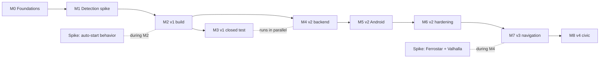

# Implementation Plan

**Product:** Road Quality Mapper (working title)
**Status:** Draft v0.1
**Related:** [PROJECT_OVERVIEW.md](PROJECT_OVERVIEW.md), [PRD.md](PRD.md), [ARCHITECTURE.md](ARCHITECTURE.md), [TECH_STACK.md](TECH_STACK.md), [API_SPEC.md](API_SPEC.md), [DATABASE_SCHEMA.md](DATABASE_SCHEMA.md)

This plan orders the work by risk and dependency for one developer working part-time. It uses effort sizes instead of dates. Re-estimate after Milestone 1, when the biggest unknown (detection quality) becomes known.

**Effort sizes** (focused working days, including testing): **S** 1 to 2, **M** 3 to 5, **L** 6 to 10, **XL** 10 or more. These are rough guesses for one developer.

---

## 1. Strategy

1. **De-risk detection first.** If the detector cannot separate real potholes from noise, nothing else matters. Build a bare logger and collect real data before building the product around it.
2. **Ship v1 without a backend.** It delivers value alone and starts the Google Play review and testing clock early.
3. **Use the Play testing window productively.** Closed testing takes a fixed number of calendar days, so build the backend while it runs.
4. **Spike the risky v3 pieces early** (Ferrostar with Valhalla, background start behavior), well before their milestones.
5. **Keep every milestone releasable or demonstrable**, with a clear exit gate.

## 2. Milestone overview

| # | Milestone | Size | Exit gate |
|---|---|---|---|
| M0 | Foundations | M | Repo, CI, accounts and skeleton app run |
| M1 | Detection data spike | L | Detector parameters and measured precision and recall on real drives |
| M2 | v1 build: personal mapper | XL | Internal-test build meets v1 acceptance criteria |
| M3 | v1 closed test and release prep | S + waiting time | Closed test completed, v1 submitted |
| M4 | v2 backend | XL | Backend deployed, ingestion to tiles works end to end |
| M5 | v2 Android: community and routes | XL | Contribute, shared map, feedback and route candidates work |
| M6 | v2 hardening and release | L | Abuse controls, privacy review and load test done, v2 submitted |
| M7 | v3 navigation and alerts | XL | Turn-by-turn works on real drives |
| M8 | v4 civic tools | L | Complaints, report cards and exports work |

Critical path to the first public release: M0, M1, M2, M3.

Rough total effort: v1 about 30 to 45 focused days, v2 about 45 to 60, v3 about 25 to 35, v4 about 15 to 20. Recalibrate after M1 and M2.

---

## 3. Milestone details

### M0: Foundations (size M)

| ID | Task | Size |
|---|---|---|
| M0-1 | Choose app name and Android package ID | S |
| M0-2 | Create the repository with the structure in ARCHITECTURE.md (android, backend, infra, docs, tools). Put these docs in `docs/`. | S |
| M0-3 | Android skeleton: Compose, Hilt, Room, version catalog, ktlint or detekt, signing config | M |
| M0-4 | GitHub Actions: build and test Android, lint | S |
| M0-5 | Firebase project with Crashlytics and Analytics | S |
| M0-6 | Google Play Console: listing created, app signing, internal testing track | S |
| M0-7 | Privacy policy page on GitHub Pages (first version, aligned with PRD section 8) | S |
| M0-8 | MapLibre map screen showing a base map with OSM attribution | S |
| M0-9 | Try signing up for an Oracle Cloud Always Free VM now (capacity varies), check `arm64` image availability for Valhalla and PostGIS | S |

Exit gate: the app builds in CI, shows a map, and an internal-test build can be installed from Play.

### M1: Detection data spike (size L)

Goal: learn what the sensors actually produce, before designing around assumptions.

| ID | Task | Size |
|---|---|---|
| M1-1 | Minimal logger app (debug only): foreground service, writes timestamped accelerometer, gyroscope, gravity and GPS to a CSV file, with a big "tag pothole" button that records a marker | M |
| M1-2 | Choose 2 to 3 test routes in Pune with known potholes, speed breakers and a rough stretch. Survey them on foot or by video first. | S |
| M1-3 | Record drives on at least two vehicle types, at least two phone placements (mount, pocket) and at least two phones | M |
| M1-4 | Analyze in Python and Jupyter: orientation normalization, filtering, event detection, speed effect, double-impulse feature for cars | L |
| M1-5 | Define initial thresholds per vehicle type and the speed-normalization function. Write them in a short findings doc. | M |
| M1-6 | Measure precision and recall against the manual tags. Record false-positive sources. | S |
| M1-7 | Measure battery drain and CPU use of sampling and filtering for a 30-minute drive | S |
| M1-8 | Store anonymized recorded traces as test fixtures for the detector's unit tests | S |

Exit gate:
- A written findings doc with parameters and measured precision and recall.
- If targets in PRD section 10 are not reachable with thresholds alone, decide now: simplify scope (for example only severe events), add features, or plan an ML classifier before v1.

### M2: v1 build, personal mapper (size XL)

Implements PRD requirements marked v1.

**Sensing and detection**

| ID | Task | Size |
|---|---|---|
| M2-1 | Pure-Kotlin detector module (filters, gating, event detection, severity, speed breaker heuristics), with JVM tests on recorded traces | L |
| M2-2 | `TripTrackingService` (foreground service, type `location`), notification, sensor and location registration with batching | L |
| M2-3 | Event position interpolation between GPS fixes | S |
| M2-4 | Roughness windows (about 50 m) computed on the device | M |
| M2-5 | Vehicle profile selection and per-vehicle calibration factors | S |
| M2-6 | Auto-pause when stationary and low-battery stop | S |

**Storage and domain**

| ID | Task | Size |
|---|---|---|
| M2-7 | Room schema from DATABASE_SCHEMA.md Part B, DAOs, repositories, migration tests | M |
| M2-8 | Trip summary computation (distance, duration, smoothness score, counts) | S |

**UI**

| ID | Task | Size |
|---|---|---|
| M2-9 | Onboarding with permission rationale screens (location, notifications, activity if opted in) | M |
| M2-10 | Home screen with Start trip and live trip view | M |
| M2-11 | Personal map: trips colored by smoothness, hazard markers, attribution | M |
| M2-12 | Trip summary and trip history, delete trip, delete all data | M |
| M2-13 | Settings: vehicle, auto-start toggle, language, battery guidance screen | S |

**Optional in v1 (P1)**

| ID | Task | Size |
|---|---|---|
| M2-14 | Automatic trip start and stop using Activity Recognition, opt-in, with background location rationale | L |
| M2-15 | Spike: verify foreground-service start from the background on the target API level before building M2-14 fully | S |

**Quality**

| ID | Task | Size |
|---|---|---|
| M2-16 | Field test on at least two vehicle types and three phone brands (include brands with aggressive battery management) | M |
| M2-17 | Crashlytics, analytics events from PRD section 9 (no precise location) | S |
| M2-18 | Accessibility pass: font scaling, contrast, TalkBack labels | S |

Exit gate: all P0 v1 acceptance criteria in PRD section 11 pass. Internal-test build installed on real devices and used for real commutes.

### M3: v1 closed test and release prep (size S plus waiting time)

| ID | Task | Size |
|---|---|---|
| M3-1 | Recruit closed-test testers (start well before M2 ends). Verify Play's current requirement. As currently understood it is at least 12 testers for 14 continuous days for new personal accounts. | S |
| M3-2 | Store listing: icon, feature graphic, screenshots, descriptions, content rating questionnaire | S |
| M3-3 | Data safety form consistent with PRD section 8.1 | S |
| M3-4 | If auto-start is included: background location declaration and demo video | S |
| M3-5 | Closed test running, collect feedback and crashes, fix issues | M |
| M3-6 | Apply for production access and release v1 | S |

Exit gate: closed test completed with acceptable stability (PRD section 10), v1 submitted to production.

M4 starts while the closed test runs.

### M4: v2 backend (size XL)

Implements the server side of API_SPEC.md.

**Infrastructure**

| ID | Task | Size |
|---|---|---|
| M4-1 | VM or local Docker Compose: Caddy, API, PostGIS, Valhalla. Verify `arm64` images or build them. | M |
| M4-2 | OSM regional extract: download, trim to the pilot area, build Valhalla tiles | M |
| M4-3 | osm2pgsql import of `osm_way` and `osm_calming_point` | M |
| M4-4 | Backups to object storage with a tested restore, uptime monitor, Actuator metrics | S |

**Backend application**

| ID | Task | Size |
|---|---|---|
| M4-5 | Spring Boot skeleton, Flyway migrations V1 to V6 from DATABASE_SCHEMA.md | M |
| M4-6 | Config endpoint | S |
| M4-7 | Device challenge, registration with Play Integrity verification, tokens, refresh, deletion | L |
| M4-8 | `POST /v1/events` with validation, idempotent insert, rejection reasons | M |
| M4-9 | Map-matching job using Valhalla `trace_attributes`, way and bucket assignment, trip token cleanup | L |
| M4-10 | Aggregation jobs: hazard clustering, confidence, suppression, stale and fixed logic, segment statistics | L |
| M4-11 | Tiles endpoint with `ST_AsMVT`, TileJSON, visibility rules | M |
| M4-12 | Hazards, hazard detail and feedback endpoints | M |
| M4-13 | Geocoding proxy with cache and rate limiting | M |
| M4-14 | Route candidates: Valhalla alternates, comfort scoring, coverage calculation | L |
| M4-15 | Rate limiting (Bucket4j), problem-detail error handling, request IDs | M |
| M4-16 | Retention and deletion jobs, recompute queue | M |
| M4-17 | Tests: Testcontainers (PostGIS), WireMock for Valhalla and Photon, contract tests against API_SPEC.md examples | L |
| M4-18 | Spike: Ferrostar with a self-hosted Valhalla (OSRM format, banner and voice instructions) on a sample route | M |

Exit gate: with synthetic uploads, data flows from `POST /events` through matching and aggregation to tiles and route scoring on a local deployment.

### M5: v2 Android, community and routes (size XL)

| ID | Task | Size |
|---|---|---|
| M5-1 | API client (Retrofit), token handling, retry rules, update gate | M |
| M5-2 | Device registration with Play Integrity | M |
| M5-3 | Contribution opt-in screen and settings | S |
| M5-4 | Upload worker: trimming, batching, backoff, unmetered default | L |
| M5-5 | Shared map layers from tiles: road condition and hazards, with accessible styling (not color alone) | L |
| M5-6 | Hazard detail sheet, confirm and dismiss | M |
| M5-7 | Destination search UI with debounce and caching | M |
| M5-8 | Route candidates screen: three options, ETA, distance, comfort score, hazard counts, preference slider, coverage notice | L |
| M5-9 | "Open in Google Maps" hand-off | S |
| M5-10 | "Delete my data" flow end to end | M |
| M5-11 | Hindi and Marathi strings, reviewed by native speakers if possible | M |
| M5-12 | Vehicle health hints and contribution stats (P2) | S |

Exit gate: a tester can contribute a real trip, see it on the shared map after processing, get route candidates with comfort scores, and delete their data.

### M6: v2 hardening and release (size L)

| ID | Task | Size |
|---|---|---|
| M6-1 | Abuse tests: stationary devices, emulators, implausible values, replayed uploads, rate limit behavior | M |
| M6-2 | Load test of ingestion and tiles on the single VM, record the limits | M |
| M6-3 | Pilot data review: map-matching accuracy on sparse windows, hazard clustering quality, false alarms from speed breakers | M |
| M6-4 | Privacy and legal review of the policy and data practices | M |
| M6-5 | Update the Data safety form, store listing and permission declarations | S |
| M6-6 | Gate the public heatmap by minimum coverage (PRD open question 4) | S |
| M6-7 | Release v2 through closed test then production | S |

Exit gate: PRD v2 release criteria are met.

### M7: v3 navigation and alerts (size XL)

| ID | Task | Size |
|---|---|---|
| M7-1 | `POST /v1/navigation/routes` (new and reroute) with OSRM-format output | M |
| M7-2 | Ferrostar integration on MapLibre: guidance UI, off-route detection, rerouting | XL |
| M7-3 | Voice guidance, language handling, test Hindi and Marathi voices | M |
| M7-4 | Hazard proximity alerts (voice or haptic, about 100 m) with tuning to avoid alert fatigue | M |
| M7-5 | Reroute with hazard avoidance and safe fallback | M |
| M7-6 | Monsoon mode (P2) | M |
| M7-7 | Photo reports: system camera intent, private storage, report list | L |
| M7-8 | Real-drive navigation testing across several routes, including missed turns and tunnels | L |

Exit gate: turn-by-turn matches or beats the "Open in Google Maps" fallback on the test routes, with no unsafe instructions.

### M8: v4 civic tools (size L)

| ID | Task | Size |
|---|---|---|
| M8-1 | Import ward or city boundaries (open data or OSM admin boundaries) | M |
| M8-2 | Monthly area statistics job and report-card endpoint with data-sufficiency rules | M |
| M8-3 | Civic channels data for the first city, curated and verified | M |
| M8-4 | Complaint generator on the device (location, severity, detection count, optional photo) | M |
| M8-5 | Shareable report-card image or link | S |
| M8-6 | Pre-generated open data exports with license and attribution text. Review ODbL obligations first. | M |
| M8-7 | "Time to fix" tracking from first report to confirmed repair | S |

Exit gate: a user can generate a complaint for a real hazard, and a report card is published for an area with sufficient data.

---

## 4. Testing plan by stage

| Stage | What | How |
|---|---|---|
| Detector | Precision, recall, false alarms | Recorded traces as fixtures, field drives with manual tags |
| Service | Survives screen-off, app switching and OEM battery managers | Real devices from at least three brands |
| Battery | Impact of sensing | A 30-minute drive per device, compare against a baseline with the app closed |
| Room | Migrations | Exported schemas and migration tests |
| Backend | Logic and SQL | Testcontainers with PostGIS, WireMock for Valhalla and Photon |
| Contract | API matches docs | Examples in API_SPEC.md run as tests, OpenAPI diff in CI |
| Privacy | Trimming and deletion | Automated checks (PV-2 and PV-3 acceptance criteria) |
| Navigation | Guidance quality | GPX replay, then real drives |
| Release | Play review readiness | Checklist in PRD section 12 |

## 5. Definition of done

A task is done when:
- Code is merged with passing CI (build, tests, lint).
- New logic has tests, and detector changes include a trace-based test.
- User-facing strings are externalized for translation.
- No precise coordinates or tokens appear in release logs.
- Any new data collected is reflected in the privacy policy and Data safety mapping.
- The relevant doc (API, schema, architecture) is updated in the same change.

## 6. Working agreements

- Trunk-based development with short-lived branches and pull requests, even when working alone, so CI runs on every change.
- Conventional commit messages.
- Tag every release build, and keep a `CHANGELOG.md`.
- Keep a `DECISIONS.md` log for changes to the key decisions in ARCHITECTURE.md section 17.
- Track work as GitHub issues grouped by milestone, using the task IDs above.

## 7. Working with AI coding assistants

- Keep these docs in the repository's `docs/` folder and add a short root-level file telling the assistant to read them first (project goals, conventions, definition of done).
- Give small, well-scoped tasks that match one task ID, and ask for tests alongside code.
- Review sensor, permission, foreground-service and SQL code by hand. Mistakes there are subtle and expensive.
- Do not paste real recorded traces or user data into prompts unless they are anonymized fixtures.

## 8. Risks and contingencies

| Risk | Signal | Contingency |
|---|---|---|
| Detector quality too low | M1 targets missed | Narrow to severe events only, add features, or add the ML classifier before v1 |
| Background tracking unreliable on some brands | M2 field tests lose trips | Foreground-first design, in-app battery guidance, drop auto-start for v1 |
| Foreground-service start from background blocked | M2-15 spike fails | Keep manual start only, auto-start later |
| Oracle free VM unavailable or ARM images missing | M0-9 and M4-1 fail | Run on a local machine for the pilot, or use the smallest paid VM |
| Map-matching of sparse windows is poor | M6-3 review | Send denser windows, or match on the device with a bundled road index, or fall back to spatial clustering without way IDs |
| Alternates too similar for comfort routing | M4-14 and M5-8 testing | Show honest "similar routes" message, evaluate GraphHopper custom models |
| Ferrostar integration blocked | M4-18 spike fails | Keep "Open in Google Maps" as the navigation path, defer v3 |
| Play review delay on location permissions | M3 | Prepare declaration and video early, ship v1 without background location |
| Free-tier changes | Notice from a provider | Keep self-hosted fallbacks (Protomaps, self-hosted Photon) documented and tested |
| Scope creep | Backlog grows faster than it closes | Hold each phase to its exit gate, defer P2 items |

## 9. Next ten actions

1. Pick the app name and package ID (M0-1).
2. Create the repository and move these docs into `docs/` (M0-2).
3. Generate the Android skeleton with Compose, Hilt and Room (M0-3).
4. Set up CI (M0-4) and the Play Console listing (M0-6).
5. Try the Oracle Cloud signup and check `arm64` images (M0-9).
6. Build the minimal logger app with the tag button (M1-1).
7. Pick and pre-survey two or three test routes in Pune (M1-2).
8. Record the first drives on two vehicle types (M1-3).
9. Analyze the traces in Jupyter and write the findings doc (M1-4 to M1-6).
10. Decide the v1 detector scope from the measured results, then start M2.
