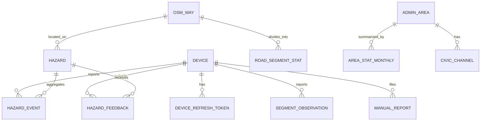

# Database Schema

**Product:** MapMyRoad
**Status:** Draft v0.1
**Related:** [ARCHITECTURE.md](ARCHITECTURE.md), [API_SPEC.md](API_SPEC.md), [TECH_STACK.md](TECH_STACK.md)

Two databases exist:

1. **Room (SQLite) on the phone**, from v1.
2. **PostgreSQL with PostGIS on the server**, from v2.

Numeric limits and retention periods are **initial values to tune**. SQL is a design sketch: validate it against the PostgreSQL and PostGIS versions in use before committing it as migrations.

---

## Part A: Server database (PostgreSQL + PostGIS), v2 onward

### A1. Conventions

| Item | Rule |
|---|---|
| Naming | `snake_case`, singular table names |
| Primary keys | UUID. Events and observations use client-generated UUIDs for idempotency. Other tables use `gen_random_uuid()`. |
| Time | `TIMESTAMPTZ`, always UTC |
| Spatial columns | `geography(…, 4326)` for hazards and segments (distances in meters). Reference OSM tables use `geometry(…, 4326)` for linear referencing. |
| Enums | `SMALLINT` or `TEXT` with `CHECK` constraints, not native enum types, so changes are simple migrations |
| Migrations | Flyway, one change set per file, never edited after release |
| Extensions | `postgis` (and `pgcrypto` only if the server version needs it for UUID generation) |

Code values:

| Column | Values |
|---|---|
| `vehicle_type` | 1 motorcycle, 2 scooter, 3 car, 4 auto_rickshaw |
| `severity` | 1 minor, 2 moderate, 3 severe |

### A2. Table overview

| Table | Purpose | Phase |
|---|---|---|
| `device` | Anonymous installs | v2 |
| `device_refresh_token` | Hashed refresh tokens | v2 |
| `osm_way` | Road geometry and tags for the supported region | v2 |
| `osm_calming_point` | Traffic-calming and level-crossing points | v2 |
| `hazard_event` | Raw detected events from devices | v2 |
| `segment_observation` | Raw roughness windows from devices | v2 |
| `hazard` | Aggregated hazards | v2 |
| `road_segment_stat` | Aggregated roughness per road segment | v2 |
| `hazard_feedback` | Confirm or dismiss votes | v2 |
| `hazard_recompute_queue` | Hazards needing recomputation after deletes | v2 |
| `geocode_cache` | Cached geocoding responses | v2 |
| `manual_report` | Private user reports with photos | v3 |
| `admin_area` | Ward and city boundaries | v4 |
| `area_stat_monthly` | Monthly report-card statistics | v4 |
| `civic_channel` | Complaint channels per area | v4 |
| `export_file` | Pre-generated open data files | v4 |

### A3. Entity relationships



### A4. Device and tokens

```sql
CREATE TABLE device (
  id            UUID PRIMARY KEY DEFAULT gen_random_uuid(),
  created_at    TIMESTAMPTZ NOT NULL DEFAULT now(),
  last_seen_at  TIMESTAMPTZ NOT NULL DEFAULT now(),
  app_version   TEXT,
  os_api_level  SMALLINT,
  trust_score   REAL NOT NULL DEFAULT 0.5 CHECK (trust_score BETWEEN 0 AND 1)
);

CREATE TABLE device_refresh_token (
  id          UUID PRIMARY KEY DEFAULT gen_random_uuid(),
  device_id   UUID NOT NULL REFERENCES device(id) ON DELETE CASCADE,
  token_hash  BYTEA NOT NULL UNIQUE,         -- SHA-256 of the opaque token
  created_at  TIMESTAMPTZ NOT NULL DEFAULT now(),
  expires_at  TIMESTAMPTZ NOT NULL,
  revoked_at  TIMESTAMPTZ
);
CREATE INDEX device_refresh_token_device_idx ON device_refresh_token (device_id);
```

The `device` row holds no personal data. Integrity challenge nonces live in an in-memory cache (short TTL), not in the database.

### A5. OSM reference tables

Loaded with osm2pgsql (flex output) for the supported region and refreshed with each OSM data update.

```sql
CREATE TABLE osm_way (
  way_id    BIGINT PRIMARY KEY,
  highway   TEXT NOT NULL,                       -- primary, residential, ...
  name      TEXT,
  surface   TEXT,
  geom      geometry(LineString, 4326) NOT NULL,
  length_m  REAL NOT NULL
);
CREATE INDEX osm_way_geom_gix ON osm_way USING GIST (geom);

CREATE TABLE osm_calming_point (
  node_id  BIGINT PRIMARY KEY,
  kind     TEXT NOT NULL CHECK (kind IN ('bump','hump','table','cushion','rumble_strip','level_crossing')),
  geom     geometry(Point, 4326) NOT NULL
);
CREATE INDEX osm_calming_point_geom_gix ON osm_calming_point USING GIST (geom);
```

Uses:
- Compute the along-way bucket for a matched point with `ST_LineLocatePoint(osm_way.geom, point)`.
- Build segment geometry with `ST_LineSubstring`.
- Suppress hazards that sit on known speed breakers or railway crossings.

### A6. Raw events and observations

```sql
CREATE TABLE hazard_event (
  id            UUID PRIMARY KEY,                 -- client-generated
  device_id     UUID REFERENCES device(id) ON DELETE CASCADE,   -- set to NULL by the retention job
  trip_token    UUID,                             -- cleared after map-matching
  hazard_id     UUID,                             -- FK added after hazard table exists
  geom          geography(Point, 4326) NOT NULL,
  heading_deg   SMALLINT CHECK (heading_deg BETWEEN 0 AND 359),
  way_id        BIGINT,
  severity      SMALLINT NOT NULL CHECK (severity BETWEEN 1 AND 3),
  vehicle_type  SMALLINT NOT NULL CHECK (vehicle_type BETWEEN 1 AND 4),
  speed_kmh     REAL NOT NULL CHECK (speed_kmh BETWEEN 0 AND 200),
  peak_score    REAL,
  observed_at   TIMESTAMPTZ NOT NULL,
  received_at   TIMESTAMPTZ NOT NULL DEFAULT now(),
  matched_at    TIMESTAMPTZ                       -- NULL until map-matched and assigned to a hazard
);
CREATE INDEX hazard_event_geom_gix     ON hazard_event USING GIST (geom);
CREATE INDEX hazard_event_device_idx   ON hazard_event (device_id);
CREATE INDEX hazard_event_hazard_idx   ON hazard_event (hazard_id);
CREATE INDEX hazard_event_observed_idx ON hazard_event (observed_at);
CREATE INDEX hazard_event_pending_idx  ON hazard_event (received_at) WHERE matched_at IS NULL;

CREATE TABLE segment_observation (
  id            UUID PRIMARY KEY,                 -- client-generated
  device_id     UUID REFERENCES device(id) ON DELETE CASCADE,
  trip_token    UUID,
  geom          geography(LineString, 4326) NOT NULL,   -- window from start to end point
  way_id        BIGINT,
  bucket        INT,                              -- floor(distance along way / 50 m)
  roughness     REAL NOT NULL CHECK (roughness >= 0),
  speed_kmh     REAL NOT NULL,
  vehicle_type  SMALLINT NOT NULL,
  observed_at   TIMESTAMPTZ NOT NULL,
  received_at   TIMESTAMPTZ NOT NULL DEFAULT now(),
  matched_at    TIMESTAMPTZ
);
CREATE INDEX segment_observation_geom_gix     ON segment_observation USING GIST (geom);
CREATE INDEX segment_observation_device_idx   ON segment_observation (device_id);
CREATE INDEX segment_observation_key_idx      ON segment_observation (way_id, bucket);
CREATE INDEX segment_observation_pending_idx  ON segment_observation (received_at) WHERE matched_at IS NULL;
```

Ingest inserts rows with `ON CONFLICT (id) DO NOTHING`. A scheduled **matching job** takes unmatched rows, groups them by `trip_token` in time order, calls Valhalla `trace_attributes` to obtain `way_id`, snaps each point to the way and computes `bucket`, then sets `matched_at` and clears `trip_token`. If matching fails or confidence is low, `way_id` stays NULL and the item is still clustered by distance only.

`segment_observation` is the largest table. If it grows too large, partition it monthly by `received_at` and drop old partitions instead of deleting rows. A partitioned table needs `received_at` in the primary key, so the key becomes `(id, received_at)`.

### A7. Aggregated tables

```sql
CREATE TABLE hazard (
  id                 UUID PRIMARY KEY DEFAULT gen_random_uuid(),
  geom               geography(Point, 4326) NOT NULL,
  way_id             BIGINT,
  severity_max       SMALLINT NOT NULL CHECK (severity_max BETWEEN 1 AND 3),
  severity_avg       REAL NOT NULL,
  event_count        INT NOT NULL DEFAULT 0,
  distinct_devices   INT NOT NULL DEFAULT 0,      -- distinct devices within the retention window
  confirm_count      INT NOT NULL DEFAULT 0,
  dismiss_count      INT NOT NULL DEFAULT 0,
  clean_pass_count   INT NOT NULL DEFAULT 0,      -- passes with low roughness and no bump
  confidence         REAL NOT NULL DEFAULT 0 CHECK (confidence BETWEEN 0 AND 1),
  status             TEXT NOT NULL DEFAULT 'active' CHECK (status IN ('active','stale','fixed')),
  suppressed_reason  TEXT CHECK (suppressed_reason IN ('osm_traffic_calming','level_crossing','repeat_pattern')),
  first_seen_at      TIMESTAMPTZ NOT NULL,
  last_seen_at       TIMESTAMPTZ NOT NULL,
  last_clean_pass_at TIMESTAMPTZ,
  fixed_at           TIMESTAMPTZ,
  updated_at         TIMESTAMPTZ NOT NULL DEFAULT now()
);
CREATE INDEX hazard_geom_gix   ON hazard USING GIST (geom);
CREATE INDEX hazard_status_idx ON hazard (status, last_seen_at);
CREATE INDEX hazard_way_idx    ON hazard (way_id);

ALTER TABLE hazard_event
  ADD CONSTRAINT hazard_event_hazard_fk
  FOREIGN KEY (hazard_id) REFERENCES hazard(id) ON DELETE SET NULL;

CREATE TABLE road_segment_stat (
  way_id             BIGINT NOT NULL,
  bucket             INT NOT NULL,
  geom               geography(LineString, 4326) NOT NULL,
  roughness_avg      REAL NOT NULL,               -- exponentially weighted average
  score              SMALLINT NOT NULL CHECK (score BETWEEN 0 AND 100),
  sample_count       INT NOT NULL DEFAULT 0,
  distinct_devices   INT NOT NULL DEFAULT 0,      -- distinct devices within the retention window
  last_observed_at   TIMESTAMPTZ NOT NULL,
  updated_at         TIMESTAMPTZ NOT NULL DEFAULT now(),
  PRIMARY KEY (way_id, bucket)
);
CREATE INDEX road_segment_stat_geom_gix ON road_segment_stat USING GIST (geom);

CREATE TABLE hazard_feedback (
  id          UUID PRIMARY KEY DEFAULT gen_random_uuid(),
  hazard_id   UUID NOT NULL REFERENCES hazard(id) ON DELETE CASCADE,
  device_id   UUID NOT NULL REFERENCES device(id) ON DELETE CASCADE,
  action      TEXT NOT NULL CHECK (action IN ('confirm','dismiss')),
  observed_at TIMESTAMPTZ NOT NULL,
  created_at  TIMESTAMPTZ NOT NULL DEFAULT now(),
  UNIQUE (hazard_id, device_id)                   -- one vote per device, latest wins (upsert)
);

CREATE TABLE hazard_recompute_queue (
  hazard_id  UUID PRIMARY KEY,
  queued_at  TIMESTAMPTZ NOT NULL DEFAULT now()
);

CREATE TABLE geocode_cache (
  cache_key   TEXT PRIMARY KEY,                   -- hash of normalized query plus bias area
  response    JSONB NOT NULL,
  created_at  TIMESTAMPTZ NOT NULL DEFAULT now(),
  expires_at  TIMESTAMPTZ NOT NULL
);
CREATE INDEX geocode_cache_expires_idx ON geocode_cache (expires_at);
```

Notes:
- Segment keys are `(way_id, bucket)`. If OSM edits split or merge ways, a reconciliation job re-keys affected rows during each OSM refresh and drops statistics that can no longer be mapped.
- `distinct_devices` is deliberately "within the retention window", because raw rows lose their device ID after that period. Corroboration therefore reflects recent data, which is what confidence should reflect.
- `road_segment_stat` is updated incrementally (exponentially weighted average). A nightly job refreshes `distinct_devices` from raw rows.

### A8. Future tables (v3 and v4)

```sql
-- v3: private manual reports
CREATE TABLE manual_report (
  id          UUID PRIMARY KEY DEFAULT gen_random_uuid(),
  device_id   UUID NOT NULL REFERENCES device(id) ON DELETE CASCADE,
  hazard_id   UUID REFERENCES hazard(id) ON DELETE SET NULL,
  geom        geography(Point, 4326) NOT NULL,
  category    TEXT NOT NULL CHECK (category IN ('pothole','open_manhole','missing_signage','broken_divider','waterlogging','other')),
  note        TEXT CHECK (char_length(note) <= 280),
  photo_key   TEXT,                               -- object storage key, NULL if no photo
  created_at  TIMESTAMPTZ NOT NULL DEFAULT now()
);
CREATE INDEX manual_report_device_idx ON manual_report (device_id);
CREATE INDEX manual_report_geom_gix   ON manual_report USING GIST (geom);

-- v4: areas, report cards, civic channels, exports
CREATE TABLE admin_area (
  id         UUID PRIMARY KEY DEFAULT gen_random_uuid(),
  level      TEXT NOT NULL CHECK (level IN ('ward','city','district')),
  name       TEXT NOT NULL,
  code       TEXT,
  parent_id  UUID REFERENCES admin_area(id),
  geom       geometry(MultiPolygon, 4326) NOT NULL
);
CREATE INDEX admin_area_geom_gix ON admin_area USING GIST (geom);

CREATE TABLE area_stat_monthly (
  area_id              UUID NOT NULL REFERENCES admin_area(id) ON DELETE CASCADE,
  month                DATE NOT NULL,             -- first day of the month
  road_km_covered      REAL NOT NULL,
  avg_score            REAL,
  severe_active        INT NOT NULL DEFAULT 0,
  moderate_active      INT NOT NULL DEFAULT 0,
  minor_active         INT NOT NULL DEFAULT 0,
  fixed_count          INT NOT NULL DEFAULT 0,
  median_days_to_fix   REAL,
  distinct_devices     INT NOT NULL DEFAULT 0,
  PRIMARY KEY (area_id, month)
);

CREATE TABLE civic_channel (
  id          UUID PRIMARY KEY DEFAULT gen_random_uuid(),
  area_id     UUID NOT NULL REFERENCES admin_area(id) ON DELETE CASCADE,
  name        TEXT NOT NULL,
  kind        TEXT NOT NULL CHECK (kind IN ('web','app','phone','email','social')),
  contact     TEXT NOT NULL,
  notes       TEXT,
  verified_at TIMESTAMPTZ
);

CREATE TABLE export_file (
  id           UUID PRIMARY KEY DEFAULT gen_random_uuid(),
  created_at   TIMESTAMPTZ NOT NULL DEFAULT now(),
  layer        TEXT NOT NULL CHECK (layer IN ('hazards','roads')),
  format       TEXT NOT NULL CHECK (format IN ('geojson','csv')),
  object_key   TEXT NOT NULL,
  row_count    INT NOT NULL,
  license_note TEXT NOT NULL
);
```

Whether ward boundary data is available as open data for each city is an open question. If it is not, OSM administrative boundaries are the fallback.

### A9. Key queries

**Find the hazard an event belongs to** (nearest within about 12 m, on the same way when known):

```sql
SELECT h.id
FROM hazard h
WHERE ST_DWithin(h.geom, :point::geography, 12)
  AND (:way_id IS NULL OR h.way_id IS NULL OR h.way_id = :way_id)
ORDER BY ST_Distance(h.geom, :point::geography)
LIMIT 1;
```

If none is found, insert a new hazard at the event location.

**Recompute hazard statistics** for hazards that received events:

```sql
UPDATE hazard h SET
  event_count      = s.n,
  distinct_devices = s.d,
  severity_max     = s.smax,
  severity_avg     = s.savg,
  last_seen_at     = s.last_seen,
  updated_at       = now()
FROM (
  SELECT hazard_id,
         COUNT(*)                    AS n,
         COUNT(DISTINCT device_id)   AS d,       -- NULL device IDs are ignored
         MAX(severity)               AS smax,
         AVG(severity)               AS savg,
         MAX(observed_at)            AS last_seen
  FROM hazard_event
  WHERE hazard_id = ANY(:hazard_ids)
  GROUP BY hazard_id
) s
WHERE h.id = s.hazard_id;
```

**Confidence** (initial heuristic, 30-day half-life):

```sql
UPDATE hazard SET confidence = LEAST(1.0,
    LEAST(1.0, distinct_devices / 3.0)
  * EXP(-LN(2) * EXTRACT(EPOCH FROM (now() - last_seen_at)) / (30 * 86400))
  * (1 + 0.5 * (confirm_count - dismiss_count)::real / (confirm_count + dismiss_count + 2))
)
WHERE id = ANY(:hazard_ids);
```

This sketch counts every device equally. ARCHITECTURE.md section 8.2 also weights each device by `trust_score`. Add that weighting (for example a trust-weighted device count) when trust scoring is implemented in M4-10.

**Suppress known speed breakers and crossings:**

```sql
UPDATE hazard h SET suppressed_reason =
  CASE c.kind WHEN 'level_crossing' THEN 'level_crossing' ELSE 'osm_traffic_calming' END
FROM osm_calming_point c
WHERE h.suppressed_reason IS NULL
  AND ST_DWithin(h.geom, c.geom::geography, 15);
```

**Hazards near a candidate route** (route as WKT in `:route_wkt`, optionally restricted to the way IDs returned by Valhalla's `trace_attributes` with `shape_match=edge_walk`):

```sql
SELECT h.id, h.severity_max, h.confidence, h.last_seen_at
FROM hazard h
WHERE h.status = 'active'
  AND h.suppressed_reason IS NULL
  AND ST_DWithin(h.geom, ST_GeogFromText(:route_wkt), 15)
  AND (:way_ids IS NULL OR h.way_id IS NULL OR h.way_id = ANY(:way_ids));
```

The Java service applies severity weights and recency decay (see ARCHITECTURE.md, section 8.4).

**Road roughness along a route** (tight distance plus way match, to avoid picking up parallel roads):

```sql
SELECT s.way_id, s.bucket, s.score, s.sample_count,
       ST_Length(s.geom) AS length_m
FROM road_segment_stat s
WHERE s.way_id = ANY(:way_ids)
  AND ST_DWithin(s.geom, ST_GeogFromText(:route_wkt), 10);
```

**Vector tile for hazards:**

```sql
WITH tile AS (
  SELECT ST_TileEnvelope(:z, :x, :y) AS env
)
SELECT ST_AsMVT(q, 'hazards', 4096, 'geom')
FROM (
  SELECT h.id,
         h.severity_max AS sev,
         round(h.confidence::numeric, 2) AS conf,
         h.status,
         ST_AsMVTGeom(ST_Transform(h.geom::geometry, 3857), tile.env, 4096, 64, true) AS geom
  FROM hazard h, tile
  WHERE h.geom && ST_Transform(tile.env, 4326)::geography
    AND h.status = 'active'
    AND h.suppressed_reason IS NULL
    AND h.confidence >= 0.3
) q;
```

The `roads` layer is built the same way from `road_segment_stat` with `ST_AsMVT(q, 'roads', 4096, 'geom')`, filtered by the visibility rules in API_SPEC.md. The two layers are concatenated into one tile response.

### A10. Retention and deletion

Proposed retention (revisit with legal review):

| Data | Rule |
|---|---|
| `hazard_event.device_id`, `segment_observation.device_id` | Set to NULL after 90 days |
| `trip_token` | Cleared as soon as map-matching completes, and in any case after 24 hours |
| Raw event and observation rows | Deleted after 365 days (or, for partitioned tables, partitions dropped) |
| Aggregated `hazard` and `road_segment_stat` | Kept, without identifiers |
| `geocode_cache` | Rows deleted after `expires_at` (about 7 days) |
| Device with no activity for 12 months | Deleted |

Nightly retention job:

```sql
UPDATE hazard_event        SET device_id = NULL WHERE device_id IS NOT NULL AND received_at < now() - interval '90 days';
UPDATE segment_observation SET device_id = NULL WHERE device_id IS NOT NULL AND received_at < now() - interval '90 days';

UPDATE hazard_event        SET trip_token = NULL WHERE trip_token IS NOT NULL AND received_at < now() - interval '24 hours';
UPDATE segment_observation SET trip_token = NULL WHERE trip_token IS NOT NULL AND received_at < now() - interval '24 hours';

DELETE FROM hazard_event        WHERE received_at < now() - interval '365 days';
DELETE FROM segment_observation WHERE received_at < now() - interval '365 days';
DELETE FROM geocode_cache       WHERE expires_at < now();
DELETE FROM device              WHERE last_seen_at < now() - interval '12 months';
```

**Delete my data** (`DELETE /v1/devices/me`), run in one transaction:

```sql
INSERT INTO hazard_recompute_queue (hazard_id)
  SELECT DISTINCT hazard_id FROM hazard_event WHERE device_id = :device_id AND hazard_id IS NOT NULL
  ON CONFLICT DO NOTHING;
INSERT INTO hazard_recompute_queue (hazard_id)
  SELECT DISTINCT hazard_id FROM hazard_feedback WHERE device_id = :device_id
  ON CONFLICT DO NOTHING;

DELETE FROM device WHERE id = :device_id;   -- cascades to tokens, events, observations, feedback, reports
```

A background job then recomputes the queued hazards and any affected segment statistics. Photos in object storage (v3) are deleted by key from `manual_report` before the row is removed.

### A11. Privacy mapping

| Data | Personal? | Handling |
|---|---|---|
| `device.id` | Pseudonymous | Random, resettable, never in public APIs |
| `hazard_event.geom` with `device_id` | Personal (location linked to a pseudonym) | Trimmed trips, device ID removed after 90 days |
| `trip_token` | Linking key | Cleared after matching |
| `hazard`, `road_segment_stat` | Aggregated | No identifiers |
| `manual_report` (v3) | Personal | Private, deleted with the device |

### A12. Sizing (rough order of magnitude)

Assumptions: 1,000 active contributors, 20 km per day each, about 2 events per km and 20 roughness windows per km.

| Table | Rows per year (before retention) | Rows steady-state with 365-day deletion |
|---|---|---|
| `hazard_event` | about 15 million | about 15 million |
| `segment_observation` | about 150 million | too large for a single small VM |

Implications: a single free VM handles `hazard_event` comfortably. For `segment_observation`, either shorten raw retention (for example 90 days, since aggregates are maintained incrementally), partition by month, or aggregate windows on ingest and keep only a short raw buffer. Decide before scaling past a small pilot. Measure real row sizes and index sizes in the pilot before choosing.

### A13. Roles, backups and migrations

| Item | Plan |
|---|---|
| Database roles | `rq_migrator` (DDL, used by Flyway), `rq_app` (DML only, used by the API), `rq_readonly` (analysis) |
| Network | Database not exposed publicly, reachable only on the Docker network |
| Backups | Nightly `pg_dump -Fc` to object storage, restore test each month |
| Flyway files | `V1__extensions_and_device.sql`, `V2__osm_reference.sql`, `V3__events_and_observations.sql`, `V4__hazards_and_segments.sql`, `V5__feedback_and_queue.sql`, `V6__geocode_cache.sql`, `V7__retention_indexes.sql` (plain indexes on `received_at`, `last_seen_at` and refresh-token `expires_at` for the retention job), then v3 and v4 files as needed |
| Test data | Seed script generating synthetic hazards and segments around a test route for local development and tests |

---

## Part B: On-device database (Room), v1 onward

Room stores everything the app needs offline. Raw sensor samples are **not** stored.

### B1. Tables

| Table | Columns |
|---|---|
| `trip` | `id` TEXT (UUID) PK, `trip_token` TEXT, `vehicle_type` INT, `started_at` INT (epoch ms), `ended_at` INT NULL, `distance_m` REAL, `duration_s` INT, `smoothness_score` INT NULL, `minor_count` INT, `moderate_count` INT, `severe_count` INT, `start_mode` TEXT (`manual` or `auto`), `stop_reason` TEXT NULL (`manual`, `auto`, `low_battery`, `service_killed`, `permission_revoked`; same codes as the `trip_ended` analytics parameter) |
| `trip_point` | `id` INTEGER PK autoincrement, `trip_id` TEXT FK (cascade delete), `t` INT (epoch ms), `lat` REAL, `lon` REAL, `speed_mps` REAL, `accuracy_m` REAL, `roughness` REAL NULL |
| `hazard_event_local` | `id` TEXT (UUID) PK, `trip_id` TEXT FK (cascade delete), `lat` REAL, `lon` REAL, `observed_at` INT, `severity` INT, `speed_kmh` REAL, `peak_score` REAL, `heading_deg` INT NULL, `uploaded` INT (0 or 1) |
| `segment_sample_local` | `id` TEXT (UUID) PK, `trip_id` TEXT FK (cascade delete), `start_lat` REAL, `start_lon` REAL, `end_lat` REAL, `end_lon` REAL, `observed_at` INT, `length_m` REAL, `roughness` REAL, `speed_kmh` REAL, `uploaded` INT (0 or 1) |
| `upload_queue` (v2) | `id` INTEGER PK, `trip_id` TEXT FK (cascade delete), `state` TEXT (`pending`, `in_progress`, `done`, `failed`, `skipped`), `attempts` INT, `next_attempt_at` INT, `last_error` TEXT NULL |

`trip_point` is downsampled for display (about one point per second or per few seconds). Indices: `trip_point(trip_id, t)`, `hazard_event_local(trip_id)`, `segment_sample_local(trip_id)`, `upload_queue(state, next_attempt_at)`.

### B2. Example entities

```kotlin
@Entity(tableName = "trip")
data class TripEntity(
    @PrimaryKey val id: String,
    val tripToken: String,
    val vehicleType: Int,
    val startedAt: Long,
    val endedAt: Long?,
    val distanceM: Double,
    val durationS: Int,
    val smoothnessScore: Int?,
    val minorCount: Int,
    val moderateCount: Int,
    val severeCount: Int,
    val startMode: String,
)

@Entity(
    tableName = "hazard_event_local",
    foreignKeys = [ForeignKey(
        entity = TripEntity::class,
        parentColumns = ["id"],
        childColumns = ["tripId"],
        onDelete = ForeignKey.CASCADE,
    )],
    indices = [Index("tripId")],
)
data class HazardEventLocalEntity(
    @PrimaryKey val id: String,
    val tripId: String,
    val lat: Double,
    val lon: Double,
    val observedAt: Long,
    val severity: Int,
    val speedKmh: Double,
    val peakScore: Double,
    val headingDeg: Int?,
    val uploaded: Boolean = false,
)
```

### B3. Rules

- Room schema export is enabled and the JSON schema files are committed, so every migration can be tested.
- Writes from the tracking service are batched (for example every few seconds) in a single transaction to limit I/O and battery use.
- Smoothness score and counts on `trip` are computed when the trip ends and recomputed if events are edited or deleted.
- Deleting a trip cascades to its points, events and samples. "Delete all data" clears all tables and DataStore.
- Upload trimming (first and last 500 m) is applied when building upload requests. The local copy keeps the full trip so the user's own history is complete.
- Settings (vehicle type, contribution opt-in, auto-start, Wi-Fi-only uploads, language, device ID and tokens) live in DataStore. Tokens are encrypted with a key held in the Android Keystore.

### B4. Local-to-server mapping

| Local | Server |
|---|---|
| `hazard_event_local` | `hazard_event` (same `id`) |
| `segment_sample_local` | `segment_observation` (same `id`, start and end points become the window line) |
| `trip.trip_token` | `hazard_event.trip_token` and `segment_observation.trip_token`, cleared after matching |
| `trip`, `trip_point` | Never uploaded |
