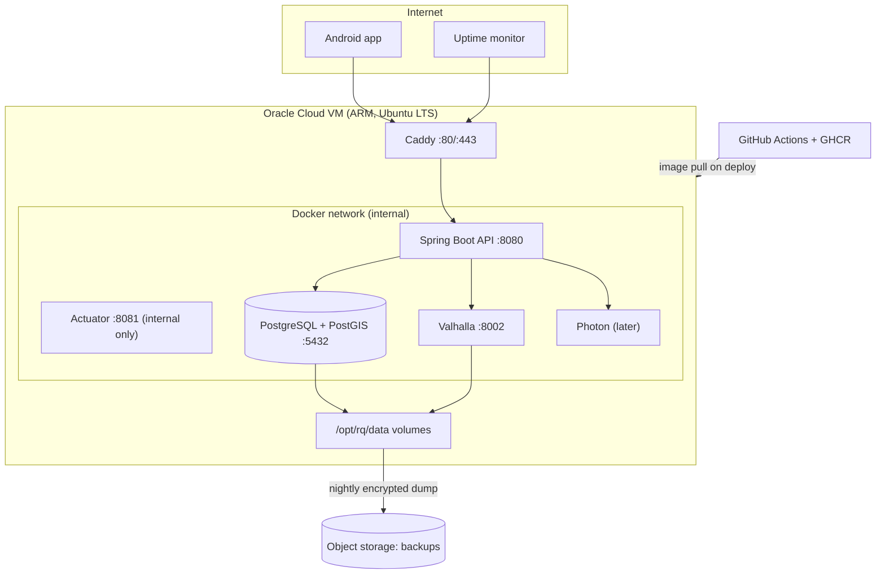

# Deployment and Operations

**Product:** MapMyRoad
**Status:** Draft v0.1
**Related:** [ARCHITECTURE.md](ARCHITECTURE.md), [TECH_STACK.md](TECH_STACK.md), [SECURITY.md](SECURITY.md), [DATABASE_SCHEMA.md](DATABASE_SCHEMA.md), [TESTING_STRATEGY.md](TESTING_STRATEGY.md)

This describes how the Android app and the backend are built, released and operated. The backend is needed from v2 onward. Everything here is a **design and sketch**: image names, versions, memory settings and free-tier limits must be checked when you implement (*verify*). Domain names are placeholders (`api.example.com`).

---

## 1. Environments

| Environment | Purpose | Where |
|---|---|---|
| Local | Development and integration tests | Your PC, Docker Compose, tiny OSM extract |
| Production | Real users | One Oracle Cloud Always Free ARM VM (or a local machine during the earliest pilot) |
| Staging (optional) | Rehearse migrations and releases | A second Compose project on the same VM when memory allows, using a small extract and its own database |

Android build variants: `debug` (logger tools, verbose logging allowed, debug API URL) and `release`. A `staging` flavor pointing at the staging API is optional.

## 2. Infrastructure overview



Only Caddy publishes ports (80 and 443). Everything else lives on the internal Docker network. Actuator listens on a separate management port that is not published and not proxied (it supersedes the "restricted by the proxy" note in API_SPEC.md section 5.13). Uptime monitors check `GET /v1/config`.

## 3. Server setup (one time)

### 3.1 Create the VM

1. Create an Oracle Cloud account (needs a card for verification, with free-tier resources not charged *verify current terms*). Choose the home region carefully, since it cannot be changed. Pick one close to your users where capacity is available.
2. Create an Always Free **ARM (Ampere A1)** instance with Ubuntu LTS. Free allowance has historically been up to 4 OCPUs and 24 GB RAM in total *verify current limits*. Capacity can be scarce, so retry later or in another availability domain if creation fails.
3. Attach a boot volume with enough space (OSM extract, Valhalla tiles, PostGIS data and backups' staging). Plan for tens of GB.
4. Networking: allow inbound TCP 80 and 443 from anywhere, and 22 only from your IP address where practical. Everything else blocked in the security list and the host firewall.
5. Reserve a static public IP and point a DNS A record (`api.example.com`) at it.

### 3.2 Base hardening

- Create a non-root user with sudo. Disable root login and password authentication in `sshd_config`. Keys only.
- Enable `unattended-upgrades` for security updates. Enable `chrony` or `systemd-timesyncd`.
- Install `ufw` (allow 22, 80, 443) and `fail2ban`.
- Install Docker Engine and the Compose plugin from the official repository.
- Note: Oracle Ubuntu images sometimes ship with restrictive default iptables rules. Check and open 80 and 443 in both the cloud security list and the host firewall.
- Full checklist: SECURITY.md section 9.

### 3.3 Directory layout

```
/opt/rq/
  compose/            docker-compose.yml, Caddyfile, .env (root-only, mode 600)
  data/
    postgres/         PostgreSQL data
    valhalla/         Valhalla config, tiles, source extract
    osm/              Downloaded extracts
  backups/            Temporary dumps before upload
  scripts/            backup.sh, restore.sh, osm-refresh.sh, deploy.sh
```

## 4. Docker Compose (sketch)

Pin image tags (and digests for production). Check that each image publishes an `arm64` build.

```yaml
# /opt/rq/compose/docker-compose.yml  (sketch, verify image names and versions)
services:
  caddy:
    image: caddy:2
    restart: unless-stopped
    ports: ["80:80", "443:443"]
    volumes:
      - ./Caddyfile:/etc/caddy/Caddyfile:ro
      - caddy_data:/data
      - caddy_config:/config
    depends_on: [api]
    networks: [edge, internal]

  api:
    image: ghcr.io/OWNER/rq-api:${API_TAG}
    restart: unless-stopped
    env_file: .env
    environment:
      SPRING_PROFILES_ACTIVE: prod
      MANAGEMENT_SERVER_PORT: "8081"
      DB_URL: jdbc:postgresql://db:5432/roadquality
      VALHALLA_URL: http://valhalla:8002
    depends_on:
      db: { condition: service_healthy }
    networks: [internal]
    mem_limit: 2g
    read_only: true
    tmpfs: [/tmp]
    healthcheck:
      test: ["CMD", "wget", "-qO-", "http://localhost:8081/actuator/health/readiness"]
      interval: 30s
      timeout: 5s
      retries: 5

  db:
    image: postgis/postgis:16-3.4      # verify an arm64 tag exists
    restart: unless-stopped
    env_file: .env
    environment:
      POSTGRES_DB: roadquality
    volumes:
      - /opt/rq/data/postgres:/var/lib/postgresql/data
    networks: [internal]
    shm_size: 256mb
    command: >
      postgres -c shared_buffers=1GB -c effective_cache_size=4GB
               -c work_mem=16MB -c maintenance_work_mem=256MB
               -c max_connections=50
    healthcheck:
      test: ["CMD-SHELL", "pg_isready -U $${POSTGRES_USER} -d roadquality"]
      interval: 10s
      timeout: 5s
      retries: 10

  valhalla:
    image: ghcr.io/gis-ops/docker-valhalla/valhalla:latest   # pin a version, verify arm64
    restart: unless-stopped
    volumes:
      - /opt/rq/data/valhalla:/custom_files
    networks: [internal]
    mem_limit: 6g

networks:
  edge: {}
  internal:
    internal: false   # outbound internet is needed for Play Integrity and Photon, no ports are published here

volumes:
  caddy_data: {}
  caddy_config: {}
```

Notes:
- Memory values are starting points for a shared 24 GB machine. Measure and adjust. Postgres settings are initial values.
- Valhalla and the database publish no ports. Only Caddy does.
- `.env` holds `API_TAG`, database user and password, JWT keys, Play Integrity credentials path and object storage keys. It is mode 600 and never committed. A committed `.env.example` lists the variable names only.

### Caddyfile

```
api.example.com {
    encode gzip
    request_body {
        max_size 2MB
    }
    header {
        Strict-Transport-Security "max-age=31536000"
        X-Content-Type-Options "nosniff"
        -Server
    }
    reverse_proxy api:8080 {
        health_uri /v1/config
        health_interval 30s
    }
    log {
        output file /data/access.log {
            roll_size 20mb
            roll_keep 5
            roll_keep_for 336h
        }
        format json
    }
}
```

Rate limiting is applied in the application (Bucket4j). Caddy's access log retention is short (14 days here) and should match the privacy policy. Consider truncating client IPs in logs (SECURITY.md section 12).

## 5. Map data pipeline

### 5.1 Initial load

1. Download the Geofabrik extract for the sub-region that contains the pilot area (check the Geofabrik index for the right India sub-region). Keep the original in `/opt/rq/data/osm/`.
2. Trim to the pilot bounding box with `osmium extract -b minLon,minLat,maxLon,maxLat in.osm.pbf -o pilot.osm.pbf` to cut memory and build time. Use the same `supportedRegion` bbox that `GET /v1/config` returns.
3. **Valhalla:** build tiles from `pilot.osm.pbf` (the image's build scripts or `valhalla_build_config` and `valhalla_build_tiles`). Set the route and `trace_attributes` limits generously enough for navigation. Test with sample requests.
4. **PostGIS reference tables:** run `osm2pgsql` with the flex style that fills `osm_way` and `osm_calming_point`.
5. Record the extract date and versions in `PROGRESS.md`.

### 5.2 Monthly refresh (zero-downtime swap)

1. Download the new extract into a new dated directory.
2. Build new Valhalla tiles in a **new directory** while the old ones keep serving.
3. Import the new reference tables into the staging schema `osm_import` (osm2pgsql never creates or drops the Flyway-owned `osm_way` and `osm_calming_point`).
4. Run the **reconciliation job**: map existing `way_id` and `bucket` keys to the new ways, re-key or drop what cannot be mapped (DATABASE_SCHEMA.md A7 notes).
5. Swap: copy staging into `osm_way` and `osm_calming_point` in one transaction (TRUNCATE plus INSERT, a brief lock instead of renaming Flyway-owned tables, see `infra/osm/README.md`), point the Valhalla container to the new directory, restart it, run smoke tests (`route` and `trace_attributes` examples). In practice the reconciliation in step 4 runs right after this copy. Implemented by `infra/scripts/osm-refresh.sh`.
6. Keep the previous version for a week for rollback.
7. Log the refresh in `PROGRESS.md`.

## 6. CI/CD

### 6.1 Workflows

| Workflow | Trigger | Steps |
|---|---|---|
| `android-ci` | PR and push to `main` | Gradle build, lint, unit tests, detector regression test, Room migration tests, dependency and secret scan |
| `backend-ci` | PR and push to `main` | Build, Spotless check, unit and integration tests (Testcontainers), contract tests, OpenAPI diff, dependency and secret scan |
| `backend-image` | Tag `backend-v*` | Build a multi-arch image (`linux/arm64`, and `linux/amd64` for local use) with Buildx, push to GitHub Container Registry |
| `deploy-backend` | Manual (workflow dispatch) with an approval gate | SSH to the VM, back up the database, pull the tagged image, `docker compose up -d`, run smoke tests, roll back automatically on failure |
| `android-release` | Tag `android-v*` | Build a signed release bundle (`.aab`), upload to the Play internal track, upload mapping files |
| `nightly` | Schedule | Routing integration test against Valhalla with a tiny extract, longer instrumented tests |

CI rules (SECURITY.md section 11): actions pinned by SHA, minimal permissions per workflow, secrets only from GitHub encrypted secrets, branch protection on `main`.

### 6.2 Deploy script (sketch)

```bash
#!/usr/bin/env bash
# /opt/rq/scripts/deploy.sh <api-tag>
set -euo pipefail
TAG="$1"
cd /opt/rq/compose

/opt/rq/scripts/backup.sh                      # always back up first
export API_TAG="$TAG"
sed -i "s/^API_TAG=.*/API_TAG=${TAG}/" .env
docker compose pull api
docker compose up -d api                        # Flyway runs on startup

for i in $(seq 1 30); do
  if curl -fsS https://api.example.com/v1/config >/dev/null; then
    echo "healthy"; exit 0
  fi
  sleep 5
done
echo "health check failed, rolling back" >&2
/opt/rq/scripts/rollback.sh                     # restores the previous API_TAG
exit 1
```

### 6.3 Database migration policy

- Flyway runs at application start. Migrations must be **backward compatible with the previous app version** whenever possible (expand, then migrate, then contract across two releases), so a rollback of the app does not break.
- A migration that cannot be backward compatible is marked in the PR and deployed with a planned maintenance window and a restore point.
- Large data changes run as a separate job, not inside a startup migration.

## 7. Android release process

### 7.1 Signing and build

- Use **Play App Signing**. Keep the upload key offline (and as an encrypted CI secret if CI signs). If the upload key is lost, Google can reset it.
- Release builds: R8 enabled, not debuggable, debug-only code absent (the sensor logger from M1 is never in release).
- Upload mapping files to Crashlytics and Play Console for readable stack traces.
- `versionCode` increments on every upload (for example derived from the CI run number or a monotonically increasing integer). `versionName` follows semantic versioning (`1.0.0`).

### 7.2 Tracks and rollout

| Track | Use |
|---|---|
| Internal testing | Every release candidate, immediate availability to your accounts |
| Closed testing | The Play-required testers group (verify the current rule), pilot users |
| Production | Staged rollout: about 10%, then 50%, then 100%, pausing if crash-free sessions or ANRs worsen |

### 7.3 Play Console checklist per release

- [ ] Release notes in all supported languages.
- [ ] Data safety form matches the build (PRD section 8.1).
- [ ] Target API level meets the current requirement.
- [ ] Permission declarations current (background location declaration and demo video if auto-start is included).
- [ ] Content rating and app access information up to date.
- [ ] Pre-launch report reviewed.
- [ ] Backend deployed and healthy **before** the app version that needs it is rolled out. Backend stays backward compatible with older apps (API_SPEC.md section 7).
- [ ] Minimum supported app version (`/v1/config`) updated only when truly necessary.

### 7.4 Updating the minimum supported version

Raise `minSupportedAppVersion` only for security or breaking reasons, and only after most users have updated. Never set it above the `versionName` of the newest released (or, during development, the current debug) app build, or every request from that build gets `426` and the app shows its update screen. Before the first release the app is `0.1.0`, so the default minimum is `0.1.0`. The app shows a clear update screen on `426` (UI_UX_GUIDELINES.md section 8).

## 8. Configuration and secrets

Production configuration is environment variables loaded from `/opt/rq/compose/.env` (mode 600, owned by root). Typical variables:

| Variable | Purpose |
|---|---|
| `API_TAG` | Image tag to run |
| `POSTGRES_USER`, `POSTGRES_PASSWORD` | Database credentials (app role and migrator role have separate passwords) |
| `JWT_KEYS` | Signing keys with key IDs, newest first |
| `PLAY_INTEGRITY_SA_FILE` | Path to the mounted service account JSON (mounted read-only) |
| `SUPPORTED_REGION_BBOX` | Region limits (also shown by `/v1/config`) |
| `VALHALLA_URL`, `PHOTON_URL` | Upstream services |
| `BACKUP_BUCKET`, `BACKUP_KEY_ID`, `BACKUP_KEY` | Object storage |
| `BACKUP_AGE_RECIPIENT` | Public key used to encrypt backups (the private key stays offline) |
| `RETENTION_DAYS_*` | Retention values (defaults match DATABASE_SCHEMA.md A10) |
| `UPLOADS_ENABLED` | Kill switch for ingestion |

Configuration changes follow the same discipline as code: record them in `PROGRESS.md`, never put secrets in chat tools or tickets.

## 9. Backups and recovery

### 9.1 Targets (initial)

| Item | Target |
|---|---|
| RPO (maximum data loss) | 24 hours |
| RTO (time to restore service) | A few hours, since there is one VM and one person |
| Backup retention | 7 daily, 4 weekly, 3 monthly |

### 9.2 Backup script (sketch)

```bash
#!/usr/bin/env bash
# /opt/rq/scripts/backup.sh
set -euo pipefail
TS=$(date -u +%Y%m%dT%H%M%SZ)
OUT=/opt/rq/backups/rq_${TS}.dump

docker compose -f /opt/rq/compose/docker-compose.yml exec -T db \
  pg_dump -U "$POSTGRES_USER" -Fc roadquality > "$OUT"

age -r "$BACKUP_AGE_RECIPIENT" -o "${OUT}.age" "$OUT"
rm -f "$OUT"

# upload with the tool of your choice (rclone or aws cli with the R2/Oracle S3-compatible endpoint)
rclone copyto "${OUT}.age" "remote:${BACKUP_BUCKET}/db/$(basename "${OUT}.age")"
rm -f "${OUT}.age"
```

Schedule with cron or a systemd timer at a quiet hour. Alert if the job fails or if the newest backup is older than 26 hours.

What is **not** backed up (it can be rebuilt): Valhalla tiles, OSM extracts, reference tables from osm2pgsql, tile caches. Keep the build steps documented and scripted.

### 9.3 Restore drill (monthly)

1. Start a clean Postgres container (local or temporary).
2. Download the latest backup, decrypt with the offline key, run `pg_restore`.
3. Run Flyway validation, row counts and a few spatial queries.
4. Record the time taken and any problems in `PROGRESS.md`.

### 9.4 Disaster recovery outline

1. Provision a new VM (section 3), restore the repository secrets from offline storage.
2. Restore the latest database backup.
3. Rebuild Valhalla tiles and reference tables from the extract (section 5).
4. Point DNS at the new IP, verify with smoke tests.
5. Clients recover automatically because they upload from local storage (idempotent IDs).

## 10. Monitoring and alerting

| Signal | Source | Alert |
|---|---|---|
| Availability | External uptime monitor on `GET /v1/config`, sending the header `X-App-Version: 9999.0.0` (the API rejects `/v1/**` requests without it) | Down for 5 minutes |
| API error rate and latency | Micrometer metrics (Prometheus scraping the management port) | 5xx above a threshold, p95 above target |
| Ingestion backlog | Count of unmatched rows (`matched_at IS NULL`) | Growing for more than an hour |
| Job failures | Job metrics and logs | Any failure of matching, aggregation, retention or backup |
| Disk usage | Node metrics or a simple script | Above 80% |
| Memory and CPU | Node metrics | Sustained above 80% (upgrade trigger) |
| Certificate expiry | Caddy renews automatically, plus an external check | Under 14 days |
| Security counters | Integrity failures, token reuse, rate-limit hits, rejected upload reasons | Spikes (SECURITY.md section 12) |
| Backup freshness | Backup script heartbeat | Older than 26 hours |

Grafana is optional. A free hosted uptime monitor plus email or push alerts to your phone is enough for the pilot.

## 11. Scheduled jobs

| Job | Frequency | Notes |
|---|---|---|
| Map-matching of new events and windows | Every 1 to 5 minutes | Idempotent, batch limited |
| Hazard aggregation and confidence | Every 5 to 15 minutes | Incremental |
| Segment statistics | Incremental plus nightly refresh of distinct device counts | |
| Stale and fixed hazard evaluation | Daily | |
| Retention and deletion | Nightly | DATABASE_SCHEMA.md A10 |
| Recompute queue (after deletions) | Every few minutes | |
| Geocode cache cleanup | Daily | |
| Backup | Nightly | Section 9 |
| OSM refresh | Monthly | Section 5.2 |
| Area statistics (v4) | Monthly | |
| Export generation (v4) | Monthly | |

## 12. Runbooks

### 12.1 API is down

1. Check the uptime monitor and `docker compose ps`.
2. Read recent logs: `docker compose logs --tail=200 api`.
3. If it is a bad release, roll back: set `API_TAG` to the previous tag and `docker compose up -d api` (section 6.2). If a migration ran that is not backward compatible, restore from the pre-deploy backup.
4. If the host is down, reboot from the cloud console. If it will not come back, follow section 9.4.
5. Remember the app keeps recording and viewing local data. Uploads queue and retry.

### 12.2 Disk full

1. Identify the culprit: `du -xh /opt/rq | sort -h | tail`.
2. Safe cleanups: old Docker images (`docker image prune`), rotated logs, old extracts, old dated Valhalla directories, temporary backups.
3. If the database is the cause, check `segment_observation` growth. Reduce raw retention or add partitioning (DATABASE_SCHEMA.md A6 and A12).
4. Temporarily set `UPLOADS_ENABLED=false` to stop growth while fixing.

### 12.3 Valhalla failing or slow

1. Check memory (`docker stats`). Rebuild or restart if the tiles were corrupted by a bad build.
2. The API returns `503 UPSTREAM_UNAVAILABLE` for route calls and ingestion continues. The matching job retries later.
3. If a new tile build is bad, point back to the previous directory (section 5.2).

### 12.4 Suspected abuse or poisoning

1. Check security counters and per-area spikes.
2. Set `UPLOADS_ENABLED=false` if needed.
3. Identify devices (trust score, volume, patterns), revoke tokens, block device IDs.
4. Remove the bad raw events and recompute affected hazards and segments (the recompute queue).
5. Record the incident (SECURITY.md section 13).

### 12.5 Suspected data leak or compromise

Follow SECURITY.md section 13: contain, preserve, assess, rotate secrets, notify as required, write the post-incident note.

### 12.6 Certificate problems

Check DNS and ports 80 and 443 (Caddy needs them for the ACME challenge). Check Caddy logs. A rate limit from the CA can occur after repeated failures, so wait before retrying.

### 12.7 Rotating secrets

JWT keys: add a new key with a new `kid` at the front, deploy, wait for the access token lifetime plus margin, then remove the old key. Database passwords: change in the database and `.env`, restart the API. Document each rotation in `PROGRESS.md`.

## 13. Rollback strategy

| Component | Rollback |
|---|---|
| Backend app | Previous image tag (section 6.2). Works when migrations are backward compatible. |
| Database migration | Restore from the pre-deploy backup if the migration is not reversible. Accept data loss since the backup. |
| Valhalla tiles | Previous tiles directory |
| Android app | Halt the staged rollout, publish a fixed version. The backend stays compatible with older app versions. Play does not support rolling users back to an older version. |
| Config | Restore the previous `.env` (keep a copy in the offline vault, without secrets in plain text in Git) |

## 14. Costs

| Item | Expected cost |
|---|---|
| Google Play developer registration | One-time fee (about $25) |
| Oracle Cloud Always Free VM | Free within limits *verify*, a card may be needed for sign-up |
| Domain | Optional, annual |
| Object storage (backups) | Free tiers should be enough early (Cloudflare R2 or Oracle) *verify* |
| GitHub (Actions, Container Registry, Pages) | Free within limits for a small project *verify private repo and package quotas* |
| Firebase Spark plan | Free |
| Public tile and geocoder services | Free fair-use. Self-host later if usage grows. |

Upgrade triggers are in ARCHITECTURE.md section 14. Review monthly once real users exist.

## 15. Local development

```bash
# one-time
cd infra
cp .env.example .env            # fill in local-only values
docker compose -f docker-compose.dev.yml up -d db   # start the API once so Flyway creates the tables
# tiny OSM extract, osm2pgsql import, Valhalla tiles (starts valhalla), synthetic seed data
./scripts/load-dev-data.sh
# later sessions: docker compose -f docker-compose.dev.yml up -d db valhalla
# run the backend from the IDE or: cd ../backend && ./mvnw spring-boot:run -Dspring-boot.run.profiles=local
```

The seed script generates synthetic hazards and segments around a test route (TESTING_STRATEGY.md section 13). Never copy production data to a development machine.

## 16. Go-live checklist (v2 backend)

- [ ] DNS, TLS and HTTPS verified, HSTS header present.
- [ ] Only ports 80 and 443 (and restricted SSH) reachable from the internet (scan from outside).
- [ ] Database, Valhalla and Actuator unreachable from outside.
- [ ] Backups running, one restore drill completed.
- [ ] Uptime monitor and alerts tested (trigger a fake outage).
- [ ] Kill switch tested.
- [ ] Retention and deletion jobs verified against test data.
- [ ] Rate limits and size limits tested.
- [ ] Play Integrity enforcement on, with a real device registration tested.
- [ ] Privacy policy matches the deployed behavior, support contact published.
- [ ] Security checklists (SECURITY.md sections 8, 9 and 17) passed.
- [ ] Runbooks reviewed, secrets inventory and offline vault in place.
- [ ] Load test results recorded and capacity limits known.
